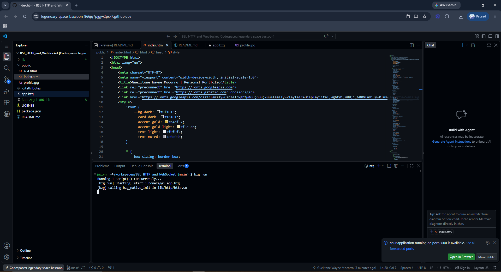
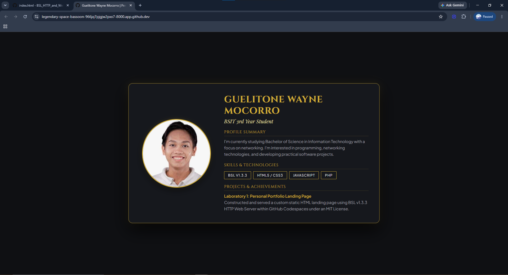

# Laboratory 1: Personal Portfolio Landing Page

**Course:** CCC181 - Application Development and Emerging Technologies  
**Student:** Guelitone Wayne Mocorro  
**Program & Year:** BSIT - 3rd Year  
**Framework / Stack:** Bonezegei Scripting Language (BSL v1.3.3), HTML5, CSS3  
**Environment:** GitHub Codespaces (Linux Ubuntu Container)  
**License:** MIT License  

---

## Executive Summary

This repository contains the complete implementation and documentation for **Laboratory 1: Personal Portfolio Landing Page** in `CCC181`. The project demonstrates the configuration of low-level HTTP server routing, static asset delivery, and responsive frontend UI architecture using the **Bonezegei Scripting Language (BSL v1.3.3)** web framework.

The landing page features a customized **luxury dark aesthetic** with gold geometric highlights (`#d4af37`), circular profile image framing, typography styling, structured technical skills badges, and project showcase sections.

---

## Tech Stack & Environment

| Component | Specification / Technology |
| :--- | :--- |
| **Language & Engine** | Bonezegei Scripting Language (BSL v1.3.3) |
| **Web Server** | BSL Low-Level HTTP/WebSocket Server (`lib/http.bzg`) |
| **Frontend Markup** | Semantic HTML5 & Custom Embedded CSS3 |
| **Typography** | Google Fonts (*Cinzel*, *Playfair Display*, *Plus Jakarta Sans*) |
| **Development Environment** | GitHub Codespaces (Cloud Linux `x86_64` container) |
| **Version Control** | Git & GitHub Repository |

---

## Step-by-Step Build & Setup Process

### Step 1: Environment Setup & BSL Installation

To resolve local environment dependency conflicts and path execution limits on native Windows OS, development was transitioned to a cloud-hosted **GitHub Codespaces** Linux container.

1. **Download the BSL Release Package:**  
   Ran `wget https://github.com/bonezegei/Bonezegei_Scripting_Language/raw/refs/heads/main/Release/Latest/Bonezegei-x86.deb` in terminal.

2. **Install the Package via APT:**  
   Ran `sudo apt install ./Bonezegei-x86.deb` to install the BSL package.

3. **Verify Global Engine Installation:**  
   Ran `bonezegei -v` to confirm installation version `v1.3.3`.

4. **Install Project Dependencies:**  
   Ran `bzg install` to resolve project packages.

---

### Step 2: Project Architecture & Directory Structure

Organized static web assets and server routing entrypoints into a standard web project layout:

BSL_HTTP_and_WebSocket/
├── lib/
│   └── http.bzg           # Core BSL HTTP and WebSocket library
├── public/
│   ├── index.html         # Main luxury dark-theme UI page
│   ├── profile.jpg        # User circular profile photo
│   └── 404.html           # Fallback error page
├── app.bzg                # Server entrypoint and route handlers
├── Bonezegei-x86.deb      # BSL Debian package
├── LICENSE                # Open-source MIT License
└── README.md              # Project documentation

---

### Step 3: Backend Static Asset Routing (`app.bzg`)

Configured `app.bzg` to listen on port `8000` and process inbound HTTP GET requests. Explicit routes were created for `/` (rendering the landing page) and `/profile.jpg` (serving the portrait asset):

include("lib/http.bzg");

var server = http(8000);

// HTTP ROUTE HANDLERS
server.get = function (path, data) {
    print("GET Request: " + path);
    
    if (path == "/") {
        server.sendFile("public/index.html");
    } 
    else if (path == "/profile.jpg") {
        server.sendFile("public/profile.jpg");
    } 
    else {
        server.sendFile("public/404.html");
    }
};

// Start BSL HTTP Server Instance
server.run();

---

### Step 4: Frontend UI/UX & CSS Styling (`public/index.html`)

Created a luxury dark aesthetic inspired by high-end design templates:

* **Circular Profile Frame:** Implemented a `260px × 260px` centered circle container using `border-radius: 50%`, an accent gold border (`#d4af37`), outer drop shadows, and subtle glow effects.
* **Top Navigation Bar:** Designed a bordered navigation panel displaying section anchor links (*About*, *Skills*, *Projects*, *Contact*).
* **Typography System:** Integrated Google Fonts (*Cinzel* for headers, *Playfair Display* for taglines, and *Plus Jakarta Sans* for body text).
* **Responsive Layout:** Applied a two-column CSS Grid (`grid-template-columns: 280px 1fr`) that automatically collapses into a single-column layout on mobile viewports (`@media (max-width: 768px)`).

---

##  Verification & Local Testing

1. Started the BSL application server by running `bzg run` inside the terminal.
2. Forwarded Port `8000` to preview the application in the web browser.
3. Confirmed that:
   - The landing page renders correctly at `http://localhost:8000/`.
   - The profile picture loads inside the circular frame via `http://localhost:8000/profile.jpg`.
   - Undefined paths return the custom `public/404.html` page.

  ## 📸 Proof of Execution & Output Verification
1. Terminal Output (bzg run)

2. Browser Rendering Output
Verification of responsive rendering and image display inside the circular gold frame:

## 📜 License

This project is open-source software licensed under the MIT License.